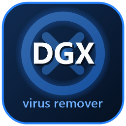

<p align="center">
  
</p>

<h1 align="center">DGX Virus Remover</h1>

<p align="center">
  Remoção e <b>desinfecção</b> de TJprojMain/Mofksys, Synaptics e Grenam — com quarentena, desfazer e proteção do dia a dia.
</p>

<p align="center">
  <a href="../../releases/latest/download/DGX-Virus-Remover.exe"><b>⬇ Baixar a versão mais recente (DGX-Virus-Remover.exe)</b></a>
  &nbsp;·&nbsp;
  <a href="../../releases">Todas as versões</a>
</p>

---

## O que ele faz

- **Desinfecta programas** atingidos por **Synaptics** (V1/V2), **Mofksys/TJprojMain** e **Grenam**: o programa original é recuperado de dentro do arquivo infectado e volta ao lugar — sem reinstalar.
- **Remove o vírus do sistema**: processos (congelados antes de encerrar), arquivos, inicialização no registro, Winlogon, IFEO, serviços e tarefas agendadas — inclusive de outros usuários e de Windows instalado em outro HD.
- **Detecções genéricas**: programas sem assinatura digital iniciando de AppData/Temp, scripts na pasta Inicializar, PowerShell oculto, Defender desligado ou com exceções perigosas, arquivo `hosts` bloqueando antivírus, proxy sequestrado e sinais do ransomware STOP/Djvu.
- **Pendrives**: vírus do atalho (atalhos falsos, pastas escondidas, scripts) e vigia automática ao conectar.
- **Quarentena** com restaurar / excluir definitivamente, **Desfazer limpeza** completo e lista de **Permitidos** para arquivos que você sabe que não são vírus.
- **Proteção**: estado do Defender, bloqueio de AutoRun, extensões visíveis e checklist da máquina limpa.
- Opcional: confirmação dos suspeitos pelo motor do **Windows Defender**.

Detalhes de cada função: [LEIA-ME.txt](LEIA-ME.txt).

## Requisitos

Windows 7, 8, 10 ou 11 com .NET Framework 4.8 (já vem no Windows 10/11). Precisa ser executado como administrador (o programa pede sozinho).

## Compilar

Não precisa de Visual Studio — usa o compilador do .NET Framework que já vem no Windows:

```bat
build.bat
```

Gera `DGX Virus Remover.exe` na raiz do projeto.

## Publicar uma versão (Release com o .exe para download)

O GitHub Actions compila sozinho e anexa o `.exe` na página de Releases quando você envia uma tag:

```bat
git tag v2.0.0
git push origin v2.0.0
```

O link fixo de download passa a ser `https://github.com/<usuario>/<repositorio>/releases/latest/download/DGX-Virus-Remover.exe`.
Antes de cada versão nova, atualize o número em `src/AssemblyInfo.cs`.

## Estrutura

| Pasta | Conteúdo |
|---|---|
| `src/` | código-fonte C# 5 / WinForms (`Families.cs` = Synaptics, Mofksys, Grenam; `Engine.Extra.cs` = detecções genéricas) |
| `assets/` | ícone e logo |
| `tools/` | `MakeLogo.cs` — regenera o ícone a partir do desenho em `src/Controls.cs` |
| `extras/` | versão original em `.bat` |
| `.github/workflows/` | build e publicação automática |
